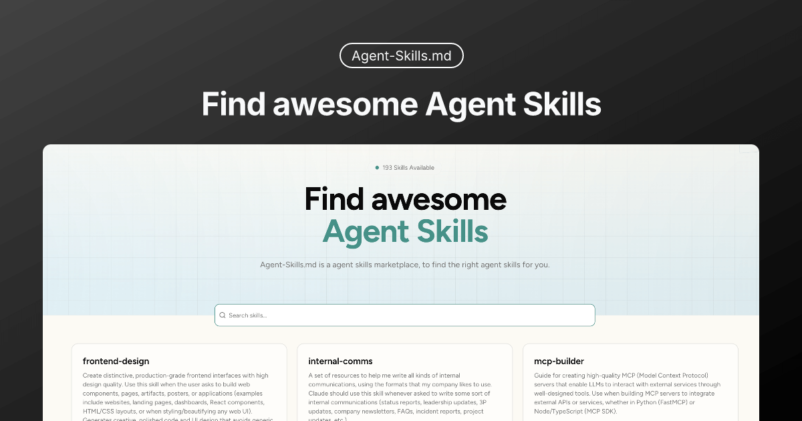

# Agent Skills



Agent Skills is a directory and explorer for AI agent skills. It indexes skill
repositories, lets you browse and preview SKILL.md instructions, and supports
downloading a complete skill folder for local use.

## Tech Stack

- Next.js (App Router)
- React
- TypeScript
- Tailwind CSS
- Drizzle ORM
- PostgreSQL
- oRPC

## Development

Install dependencies:

```bash
pnpm install
```

Start the dev server:

```bash
pnpm dev
```

Open http://localhost:3000 to view the app.
- [PromptImage](https://promptimage.cloud) - Free AI image & video studio with a prompt library (signup credits, multi-model). Freemium
- [TeslaWraps](https://teslawraps.design) - Browser Tesla Paint Shop wrap designer — core editing + PNG export free without account; optional AI credit…
- [GrokVideo Studio](https://grokvideogenerator.dev) - Independent web app for text/image-to-video via Grok Imagine API (Free Trial, 20 credits). Not an official …
- [Alors On Danse Video Maker](https://alorsondansevideo.com) - Independent AI: two photos → 13s studio dance video (Paid; not affiliated with Stromae/TikTok)
- [Bad Times AI](https://badtimesai.dev) - Independent AI dance effect: one photo → 14–15s portrait dance video (Paid from $7.99)
- [I Found You in the Crowd AI](https://ifoundyouinthecrowdai.com) - Independent AI scene effect: two photos → balcony/spotlight meeting video (Paid from $7.99)
